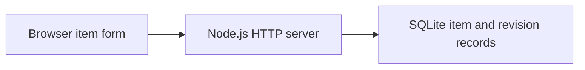
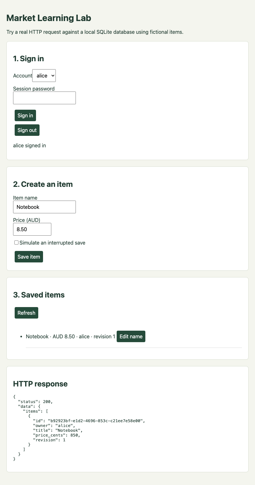

# Market Learning Lab

## Architecture

A runnable local application for following a browser request all the way to a database row.



### Follow one interaction

Sign in with a fictional account and create an item. The browser sends JSON to the server, which validates it and writes a row. Refreshing the list reads the saved row. The browser also displays the HTTP response.

## APIs and interfaces

| Connection | What crosses it |
| --- | --- |
| Browser → local HTTP server | POST /api/session signs in. POST /api/items stores an item and GET /api/items reads the saved list. A successful response contains JSON. |
| Server → SQLite and shipping provider | The server uses the Node.js SQLite API for records. A separate loopback HTTP service gives synthetic shipping quotes for the exercise. |

### Why it works this way

Each item keeps a revision and a request ID. A repeated create request and an edit to an old version can therefore be distinguished. The public edition starts with a temporary database and locally generated credentials.

## Run the public edition

Install Node.js 22.13 or newer and run this from this repository’s root. No packages or accounts are required.

```sh
node start.mjs
```

1. Open the local address printed in the terminal.
2. Choose a fictional account and enter the password printed for this session.
3. Add a notebook priced at 8.50, then select **Refresh**. The response shows the same item read from SQLite.
4. Stop with Ctrl+C. This edition keeps records in memory for the duration of the session.



Follow the code from [the browser](public/app.js) to [the HTTP service](server.mjs) and [the schema](db.mjs).

[Back to the project index](https://github.com/IT-Yun/IT-Yun)
